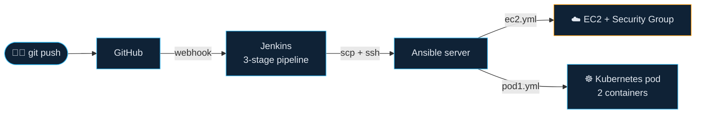
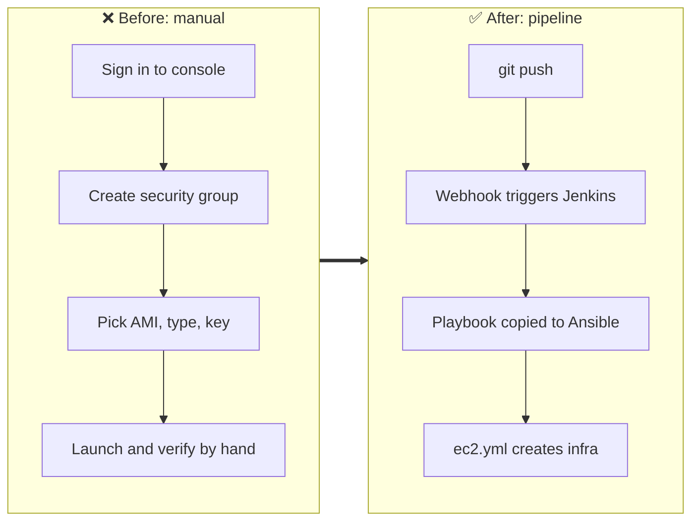
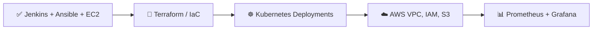

<div align="center">


<a href="https://github.com/PushpenderKumar7505"></a>

<br/>


<br/><br/>

<a href="https://www.linkedin.com/in/pushpender-kumar-5280b7226/"></a>
<a href="https://cloud-devops-shine.lovable.app/"></a>
<a href="mailto:pushpender7505@gmail.com"></a>

</div>

---

## 👨‍💻 About Me

```yaml
name:       Pushpender Kumar
role:       DevOps Engineer | AWS Cloud Engineer (Fresher)
location:   Gurugram, Haryana, India   # originally from Mathura, UP
education:  B.Tech CSE, GLA University (2024)
training:   AWS & DevOps Infrastructure, Croma Campus (NASSCOM) | Sep 2025 - Mar 2026
looking_for:
  - Junior DevOps Engineer
  - AWS Cloud Engineer
  - Cloud Infrastructure Engineer
  - Cloud Support Engineer
  - Junior SRE
work_mode:  Delhi NCR | Gurugram | Noida | Remote
available:  Immediately
```

I am a B.Tech Computer Science graduate focused on DevOps and AWS cloud infrastructure. After my AWS and DevOps training, I built two CI/CD projects on my own AWS account: Jenkins pipelines triggered by GitHub webhooks, Ansible playbooks that create EC2 resources, and a Kubernetes pod deployed from code and verified with `kubectl`.

My earlier experience is in backend development and operations support. My DevOps experience comes from training and the lab projects below.

> 💡 **Engineering approach:** automate what is repeatable, verify every step, and document the result so someone else can reproduce it.

---

## 🧰 Tech Stack

<div align="center">

**Hands-on (used in my projects)**


**Training and foundational**


**Previous backend experience**


</div>

| Area | What I have done |
|---|---|
| ☁️ **AWS** | EC2, security groups, key pairs, subnets, IAM role on the Ansible server; S3, VPC, CloudWatch at training level |
| 🔄 **CI/CD** | Jenkins Pipeline jobs, `sshagent` credentials, GitHub webhooks |
| ⚙️ **Automation** | Ansible playbooks (`amazon.aws`, `k8s`), passwordless SSH, `ansible -m ping` |
| 🐳 **Containers** | minikube on EC2, two-container pod, `kubectl` verification; Docker at lab level |
| 🐧 **Linux** | Ubuntu servers administered over SSH |

---

## 🚀 Featured Projects

<div align="center">

<a href="https://github.com/PushpenderKumar7505/Devops-automation-jenkins-ansible">
  
</a>
<a href="https://github.com/PushpenderKumar7505/Jenkins-ansible-aws-ec2-provisioning">
  
</a>

</div>

### 🔴 1. AWS Provisioning via Jenkins, Ansible and Kubernetes CI/CD

📂 [`Devops-automation-jenkins-ansible`](https://github.com/PushpenderKumar7505/Devops-automation-jenkins-ansible)

**Problem:** creating cloud resources and deploying workloads by hand is slow, error-prone and hard to repeat.
**Solution:** a three-server AWS lab. A GitHub push triggers Jenkins, Jenkins copies playbooks to an Ansible server, and Ansible either provisions an EC2 instance (`ec2.yml`) or deploys a Kubernetes pod (`pod1.yml`).

`Jenkins` `GitHub Webhooks` `Ansible` `AWS EC2` `Kubernetes (minikube)` `kubectl` `SSH/SCP` `Ubuntu`



| Component | Implementation |
|---|---|
| **Jenkins pipeline** | 3 stages: `Github connect` → `ansible-server` (scp via `sshagent`) → `ansible deploy` |
| **EC2 provisioning** | `amazon.aws.ec2_group` and `amazon.aws.ec2_instance` create a security group and instance |
| **Security** | IAM role attached to the Ansible server, so no AWS keys are stored on it |
| **Kubernetes** | `pod1.yml` applies a two-container Pod with the `k8s` module on minikube |
| **Verification** | `ansible all -m ping` returns `pong`; `kubectl get pods` shows the pod Running |

<details>
<summary><b>🔎 Limitations and next steps</b></summary>

- SSH is open to `0.0.0.0/0` on the created security group; restrict to a trusted CIDR.
- `ec2.yml` targets `us-west-2` while servers run in `ap-south-1`; move region, AMI and key into variables.
- Commit a `Jenkinsfile` for this project, as done in project 2.
- Pod runs `sleep` placeholder containers; replace with a real app and a Deployment.

</details>

### 🟡 2. Automated AWS EC2 Provisioning via Jenkins CI/CD

📂 [`Jenkins-ansible-aws-ec2-provisioning`](https://github.com/PushpenderKumar7505/Jenkins-ansible-aws-ec2-provisioning)

A GitHub push triggers the Jenkins job `Aws-project`. Its `Jenkinsfile`, stored in the repo, copies `ec2.yml` to an Ansible server and runs it to create a security group and an EC2 instance, with no AWS console steps.

`Jenkins` `GitHub Webhooks` `Ansible` `AWS EC2` `IAM Role` `Groovy` `YAML`



**Result:** 6 builds (#1 failed, #2 to #6 successful, last build about 18 seconds). Hardening steps are documented in the repository.

---

## 📚 All Repositories

| | Repository | Description | Stack |
|:-:|---|---|---|
| ☁️ | [Devops-automation-jenkins-ansible](https://github.com/PushpenderKumar7505/Devops-automation-jenkins-ansible) | CI/CD pipeline that provisions EC2 and deploys a Kubernetes pod via webhooks | Jenkins · Ansible · K8s · AWS |
| ☁️ | [Jenkins-ansible-aws-ec2-provisioning](https://github.com/PushpenderKumar7505/Jenkins-ansible-aws-ec2-provisioning) | Webhook-triggered Jenkinsfile pipeline creating EC2 with Ansible | Jenkins · Ansible · AWS |
| 🧩 | [CodeIgnitier-3-](https://github.com/PushpenderKumar7505/CodeIgnitier-3-) | PHP MVC internship project with CRUD and MySQL | PHP · CodeIgniter 3 · MySQL |
| 🧩 | [Basic_project_CI-3](https://github.com/PushpenderKumar7505/Basic_project_CI-3) | Basic starter project with CodeIgniter 3 | PHP · CodeIgniter 3 |
| 🗳️ | [E-Voting-Machine](https://github.com/PushpenderKumar7505/E-Voting-Machine) | E-voting application using blockchain | PHP |
| 🐍 | [pyhton-programming](https://github.com/PushpenderKumar7505/pyhton-programming) | Python practice programs | Python |
| 📝 | [question1](https://github.com/PushpenderKumar7505/question1) | Practice exercise | - |

🔗 Full list: [github.com/PushpenderKumar7505?tab=repositories](https://github.com/PushpenderKumar7505?tab=repositories)

---

## 💼 Experience

| Role | Organisation | Location | Period |
|---|---|---|---|
| **Associate, FTH (Incident Response)** · Contract | UnitedLex India | Gurugram | Jul 2026 |
| **Market Research Associate Intern** | Precise Research Solutions | Gurugram | Jan 2025 – Jun 2025 |
| **Backend Developer Intern** | Mentobile Technologies | India | Jul 2024 – Oct 2024 |

- **UnitedLex:** investigated data breaches and classified PII/PHI in affected datasets using Relativity and Microsoft 365.
- **Precise Research Solutions:** cleaned and analysed structured datasets; produced decision-support reports.
- **Mentobile Technologies:** built CodeIgniter (MVC) modules, designed MySQL schemas and CRUD operations; worked with Git branching, pull requests and code reviews.

---

## 🎓 Education and Training

- 🎓 **B.Tech, Computer Science and Engineering**: GLA University, Mathura (2020 – 2024)
- 📜 **AWS and DevOps Infrastructure Training**: Croma Campus, NASSCOM-certified, Wipro Credential Partner (Sep 2025 – Mar 2026)
- 📋 **Other:** Web Development Bootcamp (JOVAC) · Front End Development (Great Learning) · CCC (NIELIT)

---

## 🗺️ Learning Roadmap



---

## 📊 GitHub Stats

<div align="center">


</div>

---

## 📫 Let's Connect

<div align="center">

I am open to **Junior DevOps**, **AWS Cloud**, **Cloud Infrastructure**, **Cloud Support** and **Junior SRE** roles.
📍 **Gurugram, Haryana, India** · Delhi NCR · Noida · Remote · Can join immediately

<a href="https://www.linkedin.com/in/pushpender-kumar-5280b7226/"></a>
<a href="https://github.com/PushpenderKumar7505"></a>
<a href="https://cloud-devops-shine.lovable.app/"></a>
<a href="mailto:pushpender7505@gmail.com"></a>

<br/><br/>

*"Automate everything. Verify every step. Document the result."*


</div>
