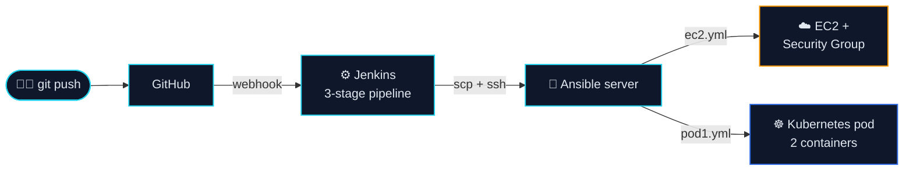
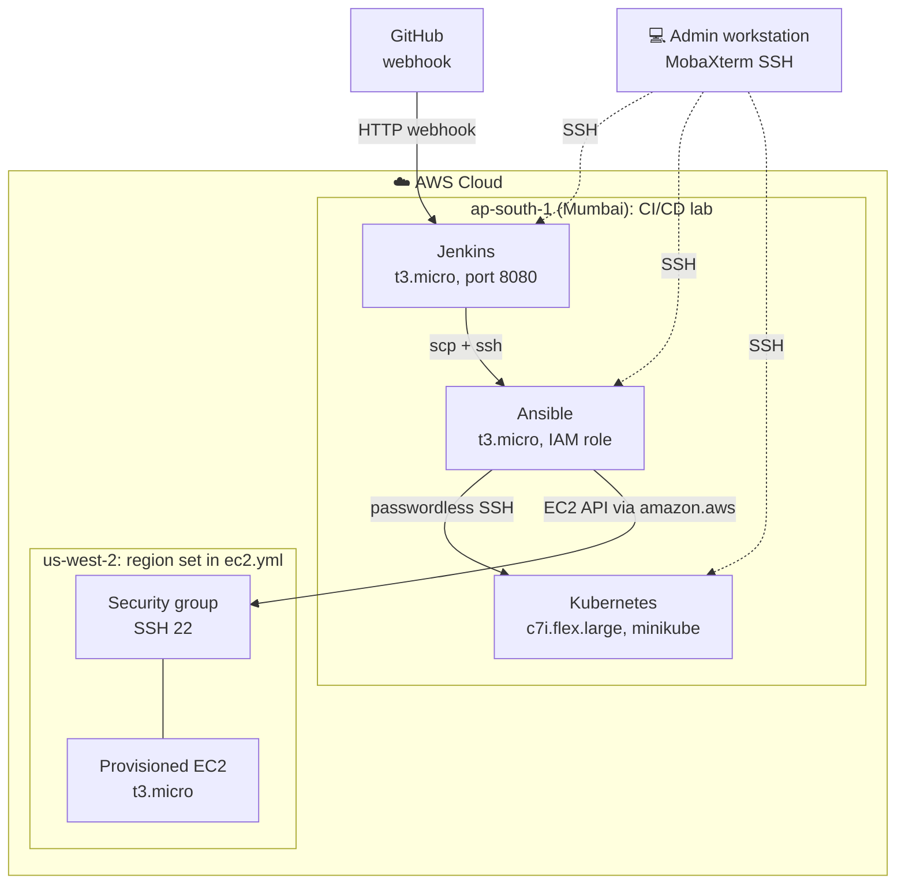
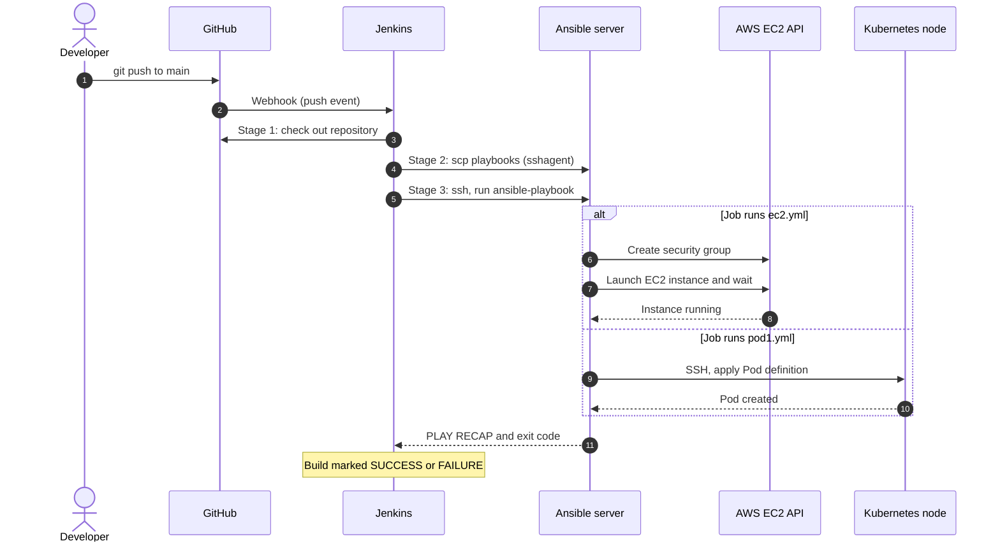
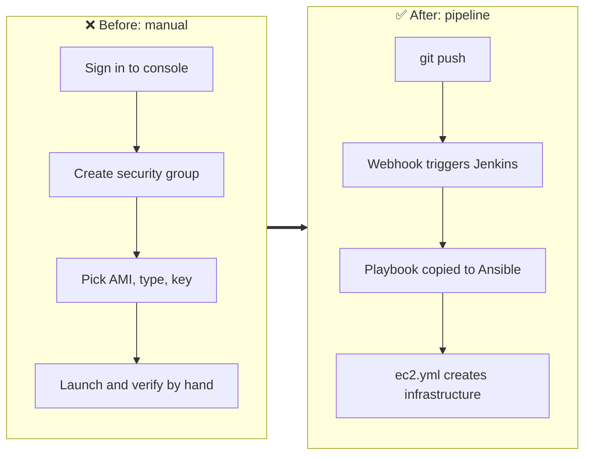
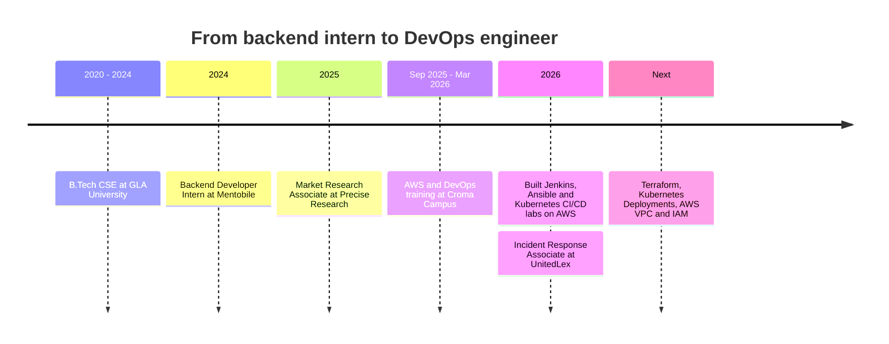
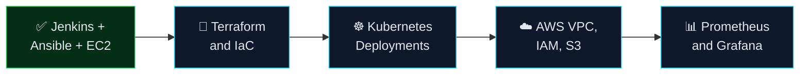

<div align="center">


<a href="https://github.com/PushpenderKumar7505"></a>

<br/>


<br/><br/>

<a href="https://www.linkedin.com/in/pushpender-kumar-5280b7226/"></a>
<a href="https://cloud-devops-shine.lovable.app/"></a>
<a href="mailto:pushpender7505@gmail.com"></a>
<a href="https://github.com/PushpenderKumar7505?tab=repositories"></a>

<br/><br/>

<a href="#-about"></a>
<a href="#-tech-stack"></a>
<a href="#-featured-projects"></a>
<a href="#-all-repositories"></a>
<a href="#-experience"></a>
<a href="#-journey"></a>
<a href="#-contact"></a>

</div>


## 👨‍💻 About

<table>
<tr>
<td width="55%" valign="top">

```yaml
name:      Pushpender Kumar
role:      DevOps | AWS Cloud Engineer (Fresher)
location:  Gurugram, Haryana, India
origin:    Mathura, Uttar Pradesh
education: B.Tech CSE, GLA University (2024)
training:  AWS & DevOps, Croma Campus (NASSCOM)
work_mode: Delhi NCR | Gurugram | Noida | Remote
joining:   Immediately
```

</td>
<td width="45%" valign="top">

**🔭 Currently building**
CI/CD pipelines on AWS with Jenkins, Ansible and Kubernetes

**🌱 Currently learning**
Terraform (IaC), Kubernetes Deployments, AWS VPC and IAM

**🎯 Looking for**
Junior DevOps · AWS Cloud · Cloud Infrastructure · Cloud Support · Junior SRE

**💬 Ask me about**
`Jenkins` `Ansible` `AWS EC2` `kubectl` `Linux`

</td>
</tr>
</table>

I am a B.Tech Computer Science graduate focused on DevOps and AWS cloud infrastructure. After AWS and DevOps training at Croma Campus, I built two CI/CD projects on my own AWS account: Jenkins pipelines triggered by GitHub webhooks, Ansible playbooks that create EC2 resources, and a Kubernetes pod deployed from code and verified with `kubectl`.

My earlier experience is in backend development and operations support. My DevOps experience comes from training and the lab projects below.

> 💡 **Engineering approach:** automate what is repeatable, verify every step, and document the result so someone else can reproduce it.


## 🧰 Tech Stack

<details open>
<summary><b>⚡ Hands-on: used in my projects</b></summary>
<br/>

<div align="center">


</div>
</details>

<details open>
<summary><b>📘 Training level: course and lab use</b></summary>
<br/>

<div align="center">


</div>
</details>

<details>
<summary><b>🧩 Previous backend experience</b></summary>
<br/>

<div align="center">


</div>
</details>

| Area | What I have done |
|---|---|
| ☁️ **AWS** | EC2, security groups, key pairs, subnets; IAM role attached to the Ansible server |
| 🔄 **CI/CD** | Jenkins Pipeline jobs, `sshagent` credentials, GitHub webhooks |
| ⚙️ **Automation** | Ansible playbooks (`amazon.aws`, `k8s`), passwordless SSH, `ansible -m ping` |
| ☸️ **Containers** | minikube on EC2, two-container pod, `kubectl` verification |
| 🐧 **Linux** | Ubuntu servers administered over SSH |


## 🚀 Featured Projects

<div align="center">

<a href="https://github.com/PushpenderKumar7505/Devops-automation-jenkins-ansible"></a>
<a href="https://github.com/PushpenderKumar7505/Jenkins-ansible-aws-ec2-provisioning"></a>

</div>

### 🔴 Project 1: AWS Provisioning via Jenkins, Ansible and Kubernetes CI/CD


📂 **Repository:** [`Devops-automation-jenkins-ansible`](https://github.com/PushpenderKumar7505/Devops-automation-jenkins-ansible)

| | |
|---|---|
| 🎯 **Problem** | Creating cloud resources and deploying workloads by hand is slow, error-prone and hard to repeat. |
| 💡 **Solution** | A GitHub push triggers Jenkins, which copies playbooks to an Ansible server. Ansible then provisions an EC2 instance (`ec2.yml`) or deploys a Kubernetes pod (`pod1.yml`). |
| 🧱 **Stack** | `Jenkins` `GitHub Webhooks` `Ansible (amazon.aws, k8s)` `AWS EC2` `Kubernetes (minikube)` `kubectl` `SSH/SCP` `Ubuntu` |



<details>
<summary><b>🏗️ AWS infrastructure layout</b></summary>



</details>

<details>
<summary><b>🔁 Execution sequence</b></summary>



</details>

| Component | Implementation |
|---|---|
| **Jenkins pipeline** | 3 stages: `Github connect` → `ansible-server` (scp via `sshagent`) → `ansible deploy` |
| **EC2 provisioning** | `amazon.aws.ec2_group` and `amazon.aws.ec2_instance` create a security group and instance |
| **Security** | IAM role attached to the Ansible server, so no AWS keys are stored on it |
| **Kubernetes** | `pod1.yml` applies a two-container Pod with the `k8s` module on minikube |

**✅ Verification**

```bash
$ ansible all -m ping            # on the Ansible server → "ping": "pong"
$ kubectl get pods               # on the Kubernetes node → croma-pod listed as Running
$ kubectl describe pod croma-pod # both containers Running, Ready: True
```

<details>
<summary><b>🔎 Limitations and next steps</b></summary>

- SSH is open to `0.0.0.0/0` on the created security group; restrict it to a trusted CIDR.
- `ec2.yml` targets `us-west-2` while servers run in `ap-south-1`; move region, AMI and key into variables.
- Commit a `Jenkinsfile` for this project, as done in project 2.
- The pod runs `sleep` placeholder containers; replace with a real app and a Deployment.

</details>

---

### 🟡 Project 2: Automated AWS EC2 Provisioning via Jenkins CI/CD


📂 **Repository:** [`Jenkins-ansible-aws-ec2-provisioning`](https://github.com/PushpenderKumar7505/Jenkins-ansible-aws-ec2-provisioning)

A GitHub push triggers the Jenkins job `Aws-project`. Its `Jenkinsfile`, stored in the repository, copies `ec2.yml` to an Ansible server and runs it to create a security group and an EC2 instance, with no AWS console steps.

`Jenkins` `GitHub Webhooks` `Ansible (amazon.aws)` `AWS EC2` `IAM Role` `Groovy` `YAML`



<details>
<summary><b>🔎 Limitations of this lab setup</b></summary>

SSH is open to `0.0.0.0/0` on the created security group, the pipeline uses `StrictHostKeyChecking=no`, Jenkins runs on plain HTTP, and the playbook region (`us-west-2`) differs from the servers (`ap-south-1`). Hardening steps are documented in the repository.

</details>


## 📚 All Repositories

| | Repository | Description | Stack |
|:-:|---|---|---|
| ☁️ | [**Devops-automation-jenkins-ansible**](https://github.com/PushpenderKumar7505/Devops-automation-jenkins-ansible) | CI/CD pipeline that provisions EC2 and deploys a Kubernetes pod via webhooks | `Jenkins` `Ansible` `K8s` `AWS` |
| ☁️ | [**Jenkins-ansible-aws-ec2-provisioning**](https://github.com/PushpenderKumar7505/Jenkins-ansible-aws-ec2-provisioning) | Webhook-triggered Jenkinsfile pipeline creating EC2 with Ansible | `Jenkins` `Ansible` `AWS` |
| 🧩 | [CodeIgnitier-3-](https://github.com/PushpenderKumar7505/CodeIgnitier-3-) | PHP MVC internship project with CRUD and MySQL | `PHP` `CodeIgniter 3` `MySQL` |
| 🧩 | [Basic_project_CI-3](https://github.com/PushpenderKumar7505/Basic_project_CI-3) | Basic starter project with CodeIgniter 3 | `PHP` `CodeIgniter 3` |
| 🗳️ | [E-Voting-Machine](https://github.com/PushpenderKumar7505/E-Voting-Machine) | E-voting application using blockchain | `PHP` |
| 🐍 | [pyhton-programming](https://github.com/PushpenderKumar7505/pyhton-programming) | Python practice programs | `Python` |
| 📝 | [question1](https://github.com/PushpenderKumar7505/question1) | Practice exercise | - |

🔗 Full list: [github.com/PushpenderKumar7505?tab=repositories](https://github.com/PushpenderKumar7505?tab=repositories)


## 💼 Experience

| Role | Organisation | Location | Period |
|---|---|---|---|
| **Associate, FTH (Incident Response)** · Contract | UnitedLex India | Gurugram | Jul 2026 |
| **Market Research Associate Intern** | Precise Research Solutions | Gurugram | Jan 2025 – Jun 2025 |
| **Backend Developer Intern** | Mentobile Technologies | India | Jul 2024 – Oct 2024 |

<details>
<summary><b>📋 What I did in each role</b></summary>

- **UnitedLex:** investigated data breaches and classified PII/PHI in affected datasets using Relativity and Microsoft 365.
- **Precise Research Solutions:** cleaned and analysed structured datasets; produced decision-support reports.
- **Mentobile Technologies:** built CodeIgniter (MVC) modules, designed MySQL schemas and CRUD operations; worked with Git branching, pull requests and code reviews.

</details>

## 🎓 Education and Training

| | Qualification | Institution | Period |
|:-:|---|---|---|
| 🎓 | **B.Tech, Computer Science and Engineering** | GLA University, Mathura | 2020 – 2024 |
| 📜 | **AWS and DevOps Infrastructure Training** (NASSCOM-certified) | Croma Campus | Sep 2025 – Mar 2026 |
| 📋 | Web Development Bootcamp | JOVAC | - |
| 📋 | Front End Development (HTML and CSS) | Great Learning | - |
| 📋 | Course on Computer Concepts (CCC) | NIELIT | - |


## 🧭 Journey



## 🗺️ Learning Roadmap




## 📊 GitHub Analytics

<div align="center">


</div>


## 📫 Contact

<div align="center">

### Let's build something reliable together

Open to **Junior DevOps Engineer** · **AWS Cloud Engineer** · **Cloud Infrastructure Engineer** · **Cloud Support Engineer** · **Junior SRE** roles

📍 **Gurugram, Haryana, India** &nbsp;·&nbsp; Delhi NCR · Noida · Remote &nbsp;·&nbsp; ⚡ Can join immediately

<br/>

<a href="https://www.linkedin.com/in/pushpender-kumar-5280b7226/"></a>
<a href="https://github.com/PushpenderKumar7505"></a>
<a href="https://cloud-devops-shine.lovable.app/"></a>
<a href="mailto:pushpender7505@gmail.com"></a>

<br/><br/>


<br/><br/>

*"Automate what is repeatable. Verify every step. Document the result."*


</div>
