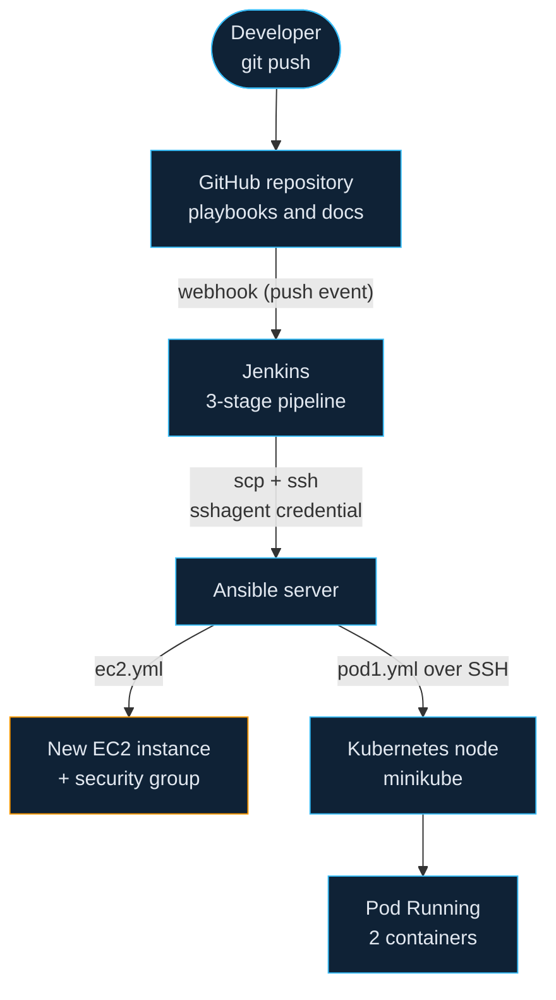
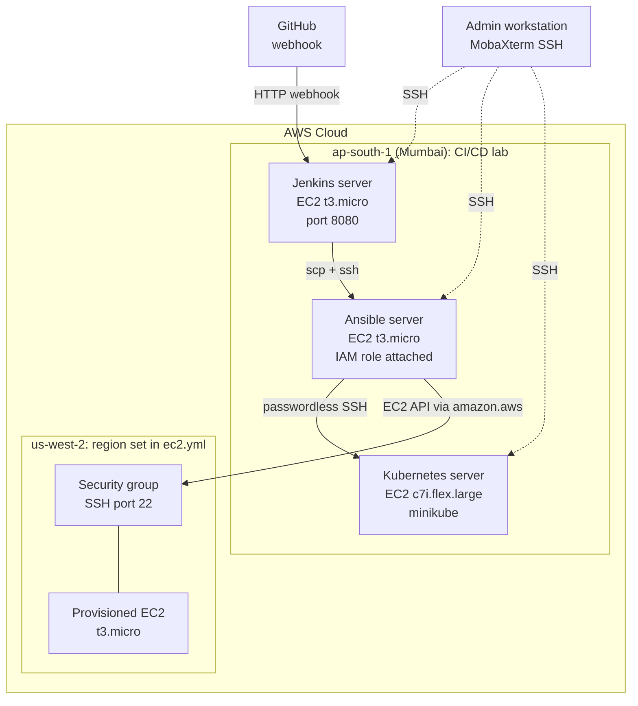
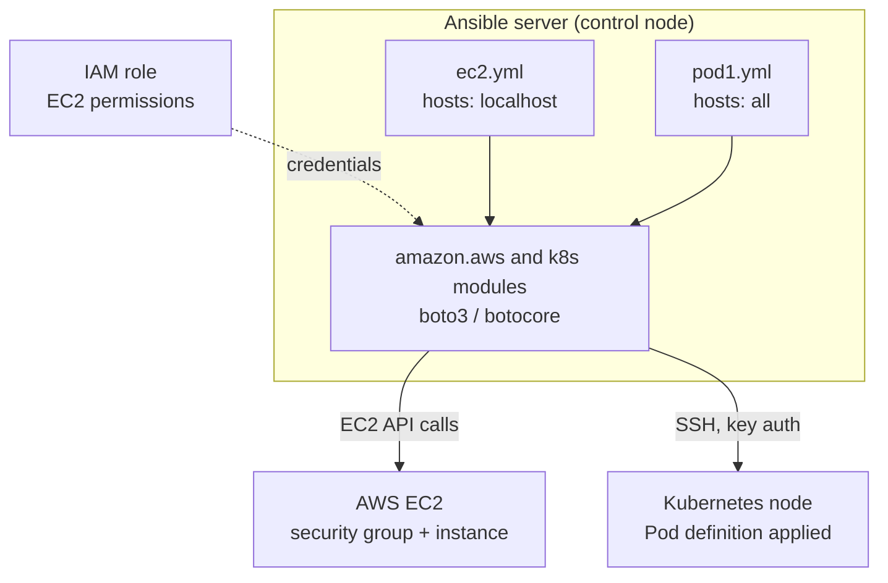
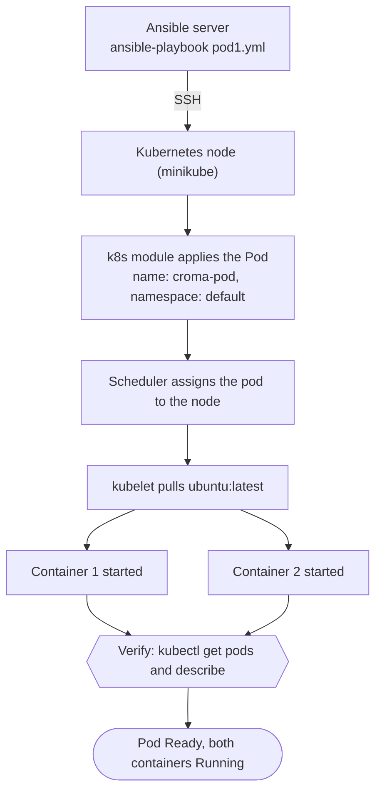
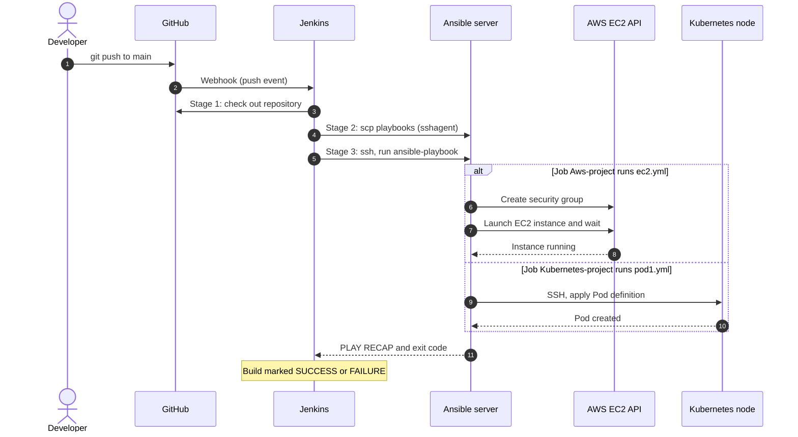
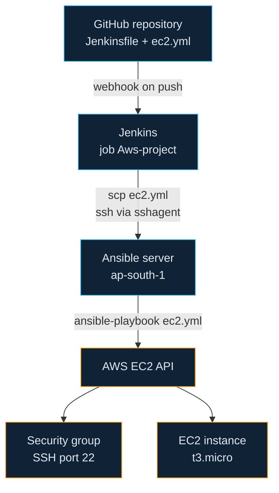
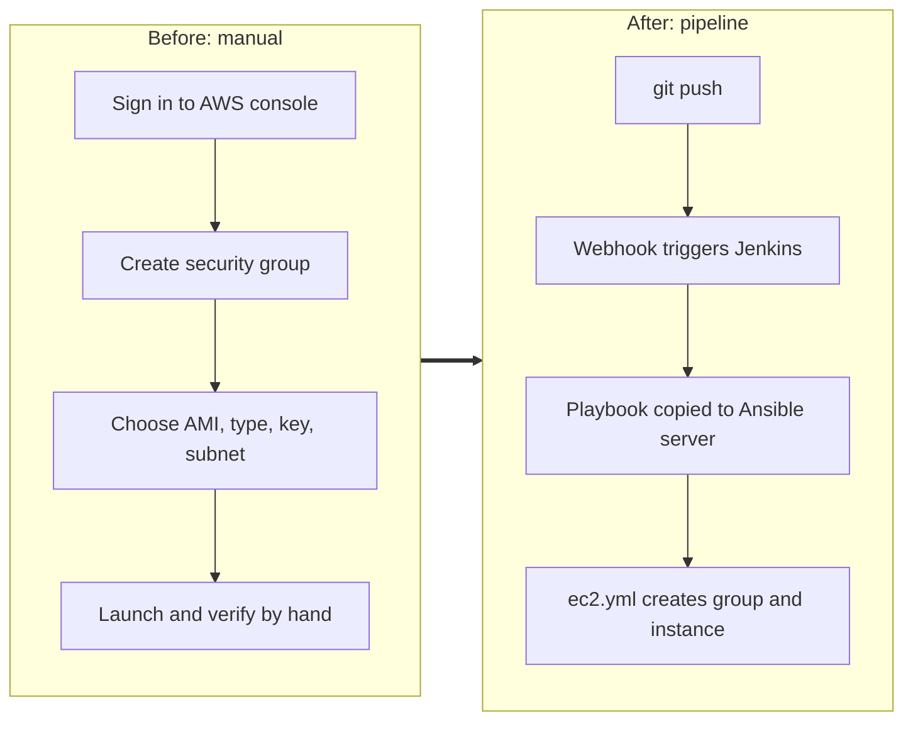

<p align="center">
  <strong>DevOps Engineer · AWS Cloud Engineer · Cloud Infrastructure</strong><br/>
  📍 Gurugram, Haryana, India &nbsp;|&nbsp; Open to Delhi NCR, Gurugram, Noida and Remote roles
</p>

<p align="center">
  <em>Building automated cloud infrastructure and reliable CI/CD workflows with AWS, Jenkins, Ansible and Kubernetes.</em>
</p>

<p align="center">
  <a href="https://github.com/PushpenderKumar7505"></a>
</p>

<p align="center">
  <a href="https://www.linkedin.com/in/pushpender-kumar-5280b7226/"></a>
  <a href="https://cloud-devops-shine.lovable.app/"></a>
  <a href="mailto:pushpender7505@gmail.com"></a>
</p>

<p align="center">
  <a href="#profile-at-a-glance">Profile</a> ·
  <a href="#about">About</a> ·
  <a href="#skills">Skills</a> ·
  <a href="#featured-projects">Projects</a> ·
  <a href="#all-repositories">Repositories</a> ·
  <a href="#experience">Experience</a> ·
  <a href="#education-and-training">Education</a> ·
  <a href="#learning-roadmap">Roadmap</a> ·
  <a href="#contact">Contact</a>
</p>

## Profile at a glance

| | |
|---|---|
| **Name** | Pushpender Kumar |
| **Current focus** | DevOps and AWS Cloud Engineering (fresher) |
| **Target roles** | Junior DevOps Engineer · AWS Cloud Engineer · Cloud Infrastructure Engineer · Cloud Support Engineer · Junior SRE |
| **Location** | Gurugram, Haryana, India (originally from Mathura, Uttar Pradesh) |
| **Work preference** | Delhi NCR, Gurugram, Noida or Remote |
| **Education** | B.Tech Computer Science and Engineering, GLA University (2024) |
| **Training** | AWS and DevOps Infrastructure, Croma Campus, NASSCOM-certified (Sep 2025 – Mar 2026) |
| **Availability** | Can join immediately |

## About

I am a B.Tech Computer Science graduate (GLA University, 2024) focused on DevOps and AWS cloud infrastructure. After completing AWS and DevOps infrastructure training at Croma Campus (Sep 2025 – Mar 2026), I built two CI/CD projects on AWS to apply it: Jenkins pipelines triggered by GitHub webhooks, Ansible playbooks that create EC2 resources, and a Kubernetes pod deployed from code and verified with `kubectl`.

My earlier experience is in backend development and operations support, not DevOps. My DevOps experience comes from training and the projects below, which are lab setups on my own AWS account. I am looking for an entry-level role where I can keep building on this foundation.

> **Engineering approach:** automate what is repeatable, verify every step, and document the result so someone else can reproduce it.

## Skills

Grouped by how I have used each technology.

### Hands-on (used in my projects)

| Area | Tools | What I have done |
|---|---|---|
| Cloud |  | EC2, security groups, key pairs, subnets; IAM role attached to the Ansible server |
| CI/CD |  | Jenkins Pipeline jobs, `sshagent` credentials, GitHub webhooks |
| Automation |  | Playbooks in YAML with the `amazon.aws` and `k8s` modules, passwordless SSH, `ansible -m ping` |
| Containers |  | Single-node minikube on EC2, two-container pod, `kubectl` verification |
| Operating systems |  | Ubuntu servers administered over SSH |

### Training and foundational knowledge

| Area | Tools | Scope |
|---|---|---|
| Infrastructure as Code |  | Training-level, hands-on projects in progress |
| Containers |  | Course and lab use |
| Scripting |  | Course and lab use |
| Monitoring |  | Course and lab use |
| AWS services |  | S3, VPC, CloudWatch at training level |

### Previous backend experience

 &nbsp; Backend internship: CodeIgniter (MVC) modules and MySQL schemas.

## Featured Projects

<a href="https://github.com/PushpenderKumar7505/Devops-automation-jenkins-ansible"></a>
<a href="https://github.com/PushpenderKumar7505/Jenkins-ansible-aws-ec2-provisioning"></a>

### 1. AWS Resource Provisioning via Jenkins, Ansible and Kubernetes CI/CD

**Repository:** [Devops-automation-jenkins-ansible](https://github.com/PushpenderKumar7505/Devops-automation-jenkins-ansible)

**Problem.** Creating cloud resources and deploying workloads by hand is slow, error-prone and hard to repeat.

**Solution.** A three-server lab on AWS. A GitHub push triggers Jenkins, Jenkins copies the playbooks to an Ansible server, and Ansible either provisions an EC2 instance (`ec2.yml`) or deploys a Kubernetes pod (`pod1.yml`). Two Jenkins jobs follow the same three-stage pattern.

**Stack:** Jenkins · GitHub webhooks · Ansible (`amazon.aws`, `k8s`) · AWS EC2 · Kubernetes (minikube) · kubectl · SSH/SCP · Ubuntu

#### End-to-end CI/CD pipeline



#### AWS infrastructure



#### How it works

| Component | Implementation |
|---|---|
| **Jenkins pipeline** | Three stages: `Github connect` (checkout), `ansible-server` (`scp` playbooks to the Ansible server through `sshagent`), `ansible deploy` (`ssh` and run `ansible-playbook`) |
| **GitHub webhook** | Push event to `/github-webhook/` on the Jenkins server (delivery verified for the `Aws-project` job) |
| **AWS EC2 provisioning** | `ec2.yml` uses `amazon.aws.ec2_group` and `amazon.aws.ec2_instance` to create a security group and an instance |
| **Ansible automation** | Playbooks run from a dedicated control node; AWS access comes from an attached IAM role, so no keys are stored on the server |
| **Passwordless SSH** | Jenkins to Ansible server through the `ansible` credential; Ansible server to the managed node with a key pair in `authorized_keys` |
| **Kubernetes deployment** | `pod1.yml` applies a two-container Pod with the `k8s` module on a minikube node |

<details>
<summary><b>More diagrams: Jenkins workflow, Ansible architecture, Kubernetes deployment, execution sequence</b></summary>

#### Jenkins pipeline workflow


#### Ansible automation architecture



#### Kubernetes deployment workflow



#### Execution sequence



</details>

#### Verification

```bash
ansible all -m ping            # on the Ansible server: expect "ping": "pong"
kubectl get pods               # on the Kubernetes node: pod listed as Running
kubectl describe pod croma-pod # both containers Running, Ready: True,
                               # event: assigned default/croma-pod to minikube
```

<details>
<summary><b>Prerequisites, execution steps, structure and limitations</b></summary>

**Prerequisites**

- Three Ubuntu EC2 instances: Jenkins, Ansible control node, Kubernetes node (minikube and `kubectl`)
- Jenkins plugins: Git, Pipeline, GitHub, SSH Agent; credential type *SSH Username with private key* (ID `ansible`)
- Ansible server: Ansible, `amazon.aws` collection, `python3-boto3`, IAM role with EC2 permissions
- Jenkins port `8080` reachable from GitHub; SSH between the servers
- `pod1.yml` uses `hosts: all`, so the inventory must contain only the Kubernetes node (or use `--limit`)

**Execution**

1. Create the servers and install Jenkins, Ansible and minikube.
2. Add the SSH public key to the managed node and the private key to Jenkins as credential `ansible`.
3. Confirm connectivity with `ansible all -m ping`.
4. Create the Jenkins Pipeline job (three stages) and the GitHub webhook `http://<jenkins-public-ip>:8080/github-webhook/`.
5. Push a commit to `main` and watch the build.

**Repository structure**

```text
Devops-automation-jenkins-ansible/
├── README.md     # documentation
├── ec2.yml       # security group + EC2 instance (amazon.aws)
├── pod1.yml      # two-container Kubernetes pod (k8s module)
└── *.png         # screenshots: Jenkins, Ansible, kubectl, AWS console
```

**Limitations and next steps**

- The security group allows SSH from `0.0.0.0/0`; restrict it to a trusted CIDR.
- `ec2.yml` targets `us-west-2` while the servers run in `ap-south-1`; move region, AMI, key and subnet into variables.
- Jenkins pipelines for this project are configured in the Jenkins UI; commit a `Jenkinsfile` as in project 2.
- The pod runs `sleep` placeholder containers; replace with a real application and a Deployment.

</details>

### 2. Automated AWS EC2 Provisioning via Jenkins CI/CD

**Repository:** [Jenkins-ansible-aws-ec2-provisioning](https://github.com/PushpenderKumar7505/Jenkins-ansible-aws-ec2-provisioning)

**Overview.** A GitHub push triggers the Jenkins job `Aws-project`. Its `Jenkinsfile`, stored in the repository, copies `ec2.yml` to an Ansible server and runs it to create a security group and an EC2 instance, with no AWS console steps.

**Stack:** Jenkins · GitHub webhooks · Ansible (`amazon.aws`) · AWS EC2 · IAM role · Groovy · YAML · Ubuntu

#### Infrastructure architecture and automation workflow



#### Before and after



| Topic | Detail |
|---|---|
| **Jenkins automation** | Job `Aws-project`, Pipeline script from SCM, stages `Github connect`, `ansible-server`, `ansible deploy` |
| **GitHub webhook** | `/github-webhook/`, `application/json`, push event; GitHub reports a successful delivery |
| **EC2 provisioning** | `ec2_group` creates the security group, `ec2_instance` launches the instance (`wait: yes`), a `debug` task prints the instance ID and state |
| **IAM permissions** | An IAM role with EC2 permissions is attached to the Ansible server, so no access keys are stored on it |
| **Execution and verification** | 6 builds: #1 failed, #2 to #6 successful (last build about 18 seconds); `ansible -m ping` returns `pong` |

<details>
<summary><b>Limitations of this lab setup</b></summary>

SSH is open to `0.0.0.0/0` on the created security group, the pipeline uses `StrictHostKeyChecking=no`, Jenkins runs on plain HTTP, and the playbook region (`us-west-2`) differs from the servers (`ap-south-1`). These are documented in the repository with planned hardening steps.

</details>

## All Repositories

A map of my public work on GitHub, grouped by area.

### DevOps and Cloud

| Repository | Description | Stack |
|---|---|---|
| [Devops-automation-jenkins-ansible](https://github.com/PushpenderKumar7505/Devops-automation-jenkins-ansible) | End-to-end CI/CD pipeline that provisions EC2 and deploys a Kubernetes pod through GitHub webhooks | Jenkins · Ansible · Kubernetes · AWS EC2 |
| [Jenkins-ansible-aws-ec2-provisioning](https://github.com/PushpenderKumar7505/Jenkins-ansible-aws-ec2-provisioning) | Webhook-triggered Jenkins pipeline (`Jenkinsfile`) that creates a security group and EC2 instance with Ansible | Jenkins · Ansible · AWS EC2 · IAM |

### Backend and web development

| Repository | Description | Stack |
|---|---|---|
| [CodeIgnitier-3-](https://github.com/PushpenderKumar7505/CodeIgnitier-3-) | PHP MVC internship project with CRUD operations and MySQL integration | PHP · CodeIgniter 3 · MySQL |
| [Basic_project_CI-3](https://github.com/PushpenderKumar7505/Basic_project_CI-3) | Basic starter project built with CodeIgniter 3 | PHP · CodeIgniter 3 |
| [E-Voting-Machine](https://github.com/PushpenderKumar7505/E-Voting-Machine) | E-voting application using blockchain | PHP |

### Practice and learning

| Repository | Description |
|---|---|
| [pyhton-programming](https://github.com/PushpenderKumar7505/pyhton-programming) | Python practice programs |
| [question1](https://github.com/PushpenderKumar7505/question1) | Practice exercise |

> Browse the complete list on my [GitHub repositories page](https://github.com/PushpenderKumar7505?tab=repositories).

## Experience

| Role | Organisation | Location | Period |
|---|---|---|---|
| Associate, FTH (Incident Response), contract | UnitedLex India | Gurugram | Jul 2026 |
| Market Research Associate Intern | Precise Research Solutions | Gurugram | Jan 2025 – Jun 2025 |
| Backend Developer Intern | Mentobile Technologies | Remote / India | Jul 2024 – Oct 2024 |

- **UnitedLex (Associate, FTH Incident Response):** investigated data breaches and classified PII/PHI in affected datasets using Relativity and Microsoft 365.
- **Precise Research Solutions (Market Research Associate Intern):** cleaned and analysed structured datasets and produced decision-support reports.
- **Mentobile Technologies (Backend Developer Intern):** built CodeIgniter (MVC) backend modules, designed MySQL schemas and CRUD operations, and worked with Git branching, pull requests and code reviews.

## Education and Training

- **B.Tech, Computer Science Engineering**, GLA University, Mathura, Uttar Pradesh (2020 – 2024)
- **AWS and DevOps Infrastructure Training**, Croma Campus, NASSCOM-certified, Wipro Credential Partner (Sep 2025 – Mar 2026)
- **Other certifications:** Web Development Bootcamp (JOVAC) · Front End Development, HTML and CSS (Great Learning) · Course on Computer Concepts, CCC (NIELIT)

## Learning Roadmap

Where I am heading next, building on the projects above:

1. **Terraform and Infrastructure as Code:** define the AWS layer of my projects as code
2. **Advanced Kubernetes:** move from a single pod to Deployments and Services
3. **AWS cloud architecture:** deepen VPC, IAM and storage knowledge beyond EC2
4. **Linux administration:** strengthen fundamentals behind every server I manage
5. **Monitoring and observability:** Prometheus and Grafana for the pipelines I build

## GitHub Analytics


## Contact

📍 **Gurugram, Haryana, India** · Open to entry-level roles as a **Junior DevOps Engineer**, **AWS Cloud Engineer**, **Cloud Infrastructure Engineer**, **Cloud Support Engineer** or **Junior SRE**. I can join immediately.

<p align="center">
  <a href="https://www.linkedin.com/in/pushpender-kumar-5280b7226/"></a>
  <a href="https://github.com/PushpenderKumar7505"></a>
  <a href="https://cloud-devops-shine.lovable.app/"></a>
  <a href="mailto:pushpender7505@gmail.com"></a>
</p>
