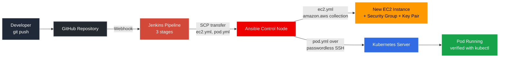
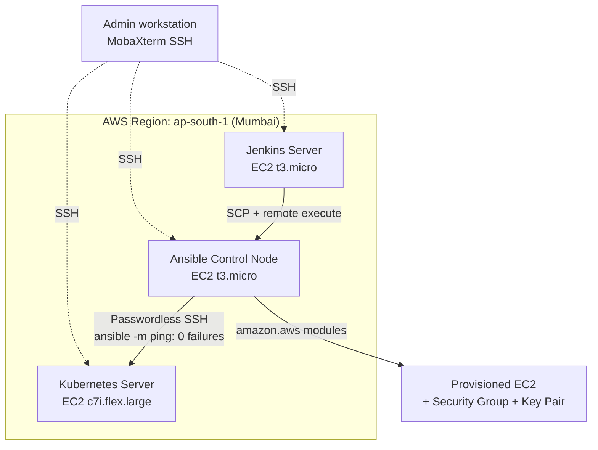
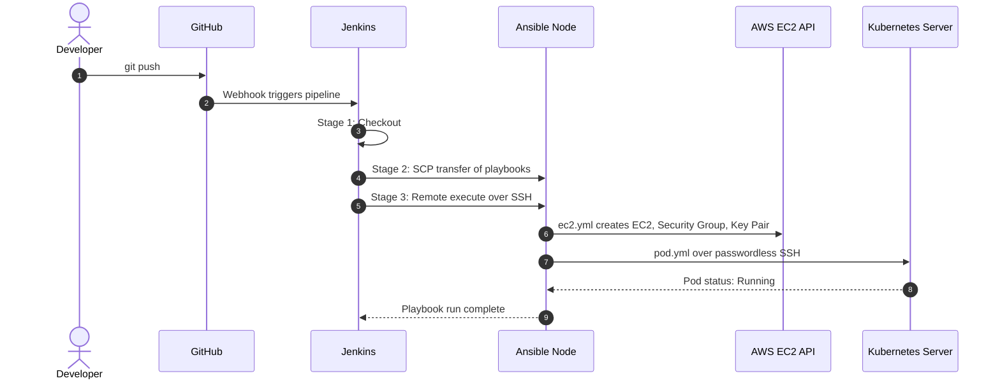
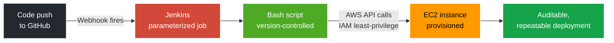
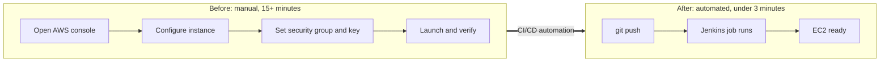

<h1 align="center">Pushpender Kumar</h1>

<b>DevOps Engineer · Cloud Engineer (Fresher) · AWS Infrastructure & CI/CD Automation</b> 
Gurugram, India · B.Tech CSE (2024) · Immediate joiner · Open to Delhi NCR and Remote roles

<a href="#-impact">Impact</a> ·
<a href="#-skills">Skills</a> ·
<a href="#-projects">Projects</a> ·
<a href="#-experience">Experience</a> ·
<a href="#-education--training">Education</a> ·
<a href="#-contact">Contact</a>

I automate AWS infrastructure provisioning and deployment pipelines so that nothing is done by hand twice. My hands-on work covers **Jenkins CI/CD, Ansible, Kubernetes on AWS EC2 and Linux administration**, built and documented end to end in the projects below.

**Target roles:** DevOps Engineer · Cloud Engineer · Cloud Support Engineer · Cloud Infrastructure Engineer (fresher / 0–1 year)

---

## 📈 Impact

| Metric | Result | Where |
|---|---|---|
| EC2 provisioning time | **15+ min → under 3 min (about 80% faster)** | Both CI/CD projects |
| Manual AWS console steps | **100% eliminated** | Both CI/CD projects |
| Ansible connectivity check (`ansible -m ping`) | **0 failures** across the 3-node setup | Project 1 |
| Kubernetes pod deployment | Confirmed **Running** via `kubectl` | Project 1 |

*Results are from hands-on lab and training projects, documented in the linked repositories.*

---

## 🧰 Skills

<b>Core stack (project-backed)</b>

| Area | Tools |
|---|---|
| **AWS** | EC2, S3, IAM, VPC, Security Groups, CloudWatch |
| **CI/CD** | Jenkins (3-stage pipelines), GitHub Webhooks, Bash |
| **Configuration Management** | Ansible (playbooks, SSH key authentication, `amazon.aws` collection) |
| **Containers & Orchestration** | Docker, Kubernetes, kubectl |
| **OS & Scripting** | Linux (Ubuntu), Bash, YAML |
| **Version Control** | Git, GitHub |

<b>Training-level and prior experience</b>

| Area | Tools |
|---|---|
| **Infrastructure as Code** | Terraform (training-level; currently building hands-on projects) |
| **Monitoring** | Prometheus, Grafana, CloudWatch |
| **Backend (prior internship)** | PHP (CodeIgniter), MySQL |

---

## 🚀 Projects

### 1. End-to-End CI/CD: Jenkins → Ansible → Kubernetes on AWS
Repository: [Devops-automation-jenkins-ansible](https://github.com/PushpenderKumar7505/Devops-automation-jenkins-ansible)

One GitHub push triggers the full chain, from EC2 provisioning to a running Kubernetes pod, with no manual steps.

**Pipeline flow**

<b>🔍 Click to expand: infrastructure layout</b>

<b>🔍 Click to expand: execution sequence</b>

| What I built | Outcome |
|---|---|
| 3-stage Jenkins pipeline (Checkout → SCP Transfer → Remote Execute) | Fully automated, no manual steps |
| Ansible `ec2.yml` using the `amazon.aws` collection | EC2, Security Group, AMI and key pair created from code |
| Passwordless SSH between Ansible control node and Kubernetes server | `ansible -m ping` returned 0 failures |
| Multi-container pod deployment triggered remotely via `pod.yml` | Pods confirmed in Running state |
| 3 EC2 instances in `ap-south-1` (Jenkins, Ansible, Kubernetes) | Managed over SSH via MobaXterm |

**Stack:** `Jenkins` `Ansible` `Kubernetes` `AWS EC2` `GitHub` `SSH/SCP` `Ubuntu`

---

### 2. Automated AWS EC2 Provisioning via Jenkins CI/CD
Repository: [Jenkins-ansible-aws-ec2-provisioning](https://github.com/PushpenderKumar7505/Jenkins-ansible-aws-ec2-provisioning)

A GitHub webhook triggers a parameterized Jenkins job that provisions EC2 on AWS, replacing manual console work.

**Pipeline flow**

<b>🔍 Click to expand: manual vs automated</b>

| What I built | Outcome |
|---|---|
| Parameterized Bash scripts run through Jenkins jobs | 100% of manual console clicks eliminated |
| GitHub Webhooks driving an event-based pipeline | Auto-trigger on every push, across 2 repositories |
| AWS IAM least-privilege policies | Scoped permissions for the automation user |
| End-to-end automated pipeline | Provisioning time: **15+ min → under 3 min** |

**Stack:** `Jenkins` `GitHub Webhooks` `AWS EC2` `AWS IAM` `Bash` `Ubuntu`

---

## 💼 Experience

| Role | Organization | Period |
|---|---|---|
| Associate (Incident Response), FTH | UnitedLex, Gurugram | Jul 2026 |
| Market Research Associate | Precise Research Solution, Gurugram | Jan 2025 – Jun 2025 |
| Backend Developer Intern | Mentobile Technology | Jul 2024 – Oct 2024 |

<b>Click to expand: responsibilities</b>

- **UnitedLex:** Investigated data breaches and classified PII/PHI in affected datasets using Relativity and Microsoft 365.
- **Precise Research Solution:** Cleaned and analysed structured datasets and produced decision-support reports for stakeholders.
- **Mentobile Technology:** Built backend modules in CodeIgniter (MVC), designed MySQL schemas and CRUD operations, and worked through Git branching, pull requests and code reviews.

---

## 🎓 Education & Training

- **B.Tech, Computer Science & Engineering**, GLA University, Mathura (2020 – 2024)
- **AWS & DevOps Infrastructure Training**, Croma Campus, NASSCOM-certified, Wipro Credential Partner (Sep 2025 – Mar 2026)

<b>Click to expand: training coverage and other courses</b>

- Linux administration, Git and GitHub workflows
- Jenkins CI/CD, GitHub Webhooks, Docker, Kubernetes
- AWS: EC2, S3, IAM, VPC, CloudWatch
- Terraform, Ansible, Prometheus, Grafana
- Web Development Bootcamp (JOVAC) · Front-End Development, HTML & CSS (Great Learning) · Course on Computer Concepts, CCC (NIELIT)

---

## 🌱 Currently Working On

- Terraform infrastructure as code on AWS
- Advanced Kubernetes
- Linux administration fundamentals

---

## 📬 Contact

