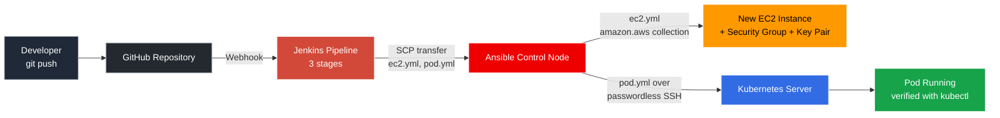
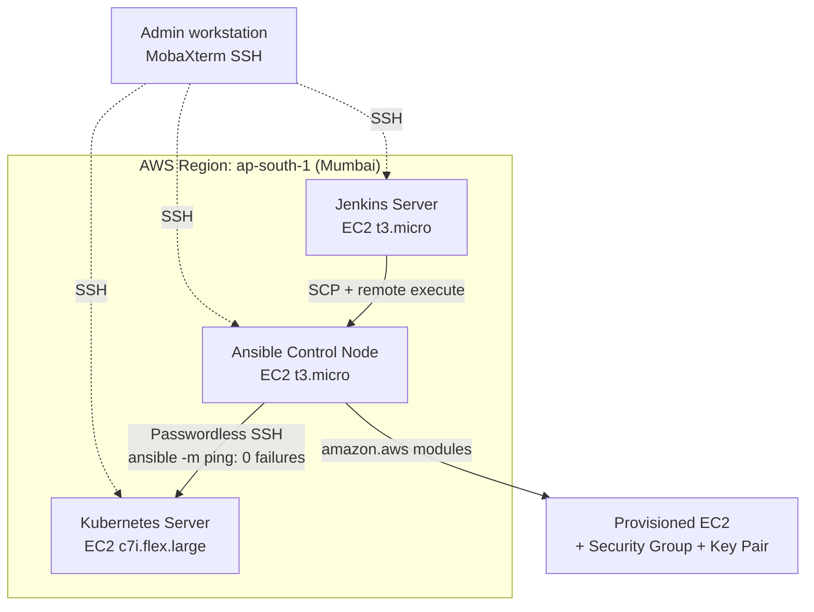
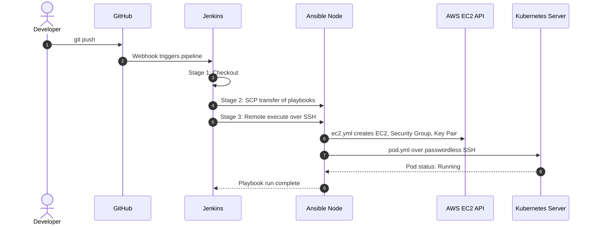
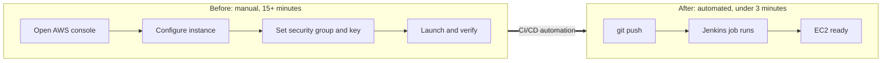

<!-- Banner -->


<!-- Typing animation -->
<p align="center">
  <a href="https://github.com/PushpenderKumar7505">
    
  </a>
</p>

<p align="center">
  
  
  
</p>

<p align="center">
  <a href="https://www.linkedin.com/in/pushpender-kumar-5280b7226/"></a>
  <a href="https://cloud-devops-shine.lovable.app"></a>
  <a href="mailto:pushpender7505@gmail.com"></a>
  
</p>

---

## 👋 About Me

```yaml
name: Pushpender Kumar
role: DevOps / Cloud Engineer (Fresher)
education: B.Tech CSE, GLA University (2024)
training: NASSCOM-certified AWS & DevOps Infrastructure (Croma Campus, Wipro Credential Partner)
focus: [AWS, Jenkins CI/CD, Ansible, Kubernetes, Linux]
location: Gurugram, India
availability: Immediate joiner (Delhi NCR / Noida / Pune / Remote)
```

> 💡 I build deployment pipelines where **a single `git push` provisions the infrastructure and ships the workload**, with no manual console clicks.

---

## 📈 Impact at a Glance

<div align="center">

| ⚡ EC2 Provisioning | 🖱️ Manual Console Steps | 🔗 Ansible Ping Check | ☸️ K8s Pod Deployment |
|:---:|:---:|:---:|:---:|
| **15+ min → under 3 min**<br>(≈80% faster) | **100% eliminated** | **0 failures**<br>(3-node setup) | **Running**<br>(verified via `kubectl`) |

<sub>Results are from hands-on lab and training projects, documented in the linked repositories.</sub>

</div>

---

## 🧰 Tech Stack

<div align="center">

**☁️ Cloud & CI/CD**<br>


**⚙️ Automation, Containers & IaC**<br>


**🐧 OS, Scripting & Monitoring**<br>


**🗄️ Prior Backend Experience**<br>


</div>

<details>
<summary><b>📋 Detailed skill breakdown</b></summary>

<br>

| Area | Tools | Level |
|---|---|---|
| **AWS** | EC2, S3, IAM, VPC, Security Groups, CloudWatch | Project-backed |
| **CI/CD** | Jenkins (3-stage pipelines), GitHub Webhooks, Bash | Project-backed |
| **Config Management** | Ansible (playbooks, SSH key auth, `amazon.aws` collection) | Project-backed |
| **Containers & Orchestration** | Docker, Kubernetes, kubectl | Project-backed |
| **OS & Scripting** | Linux (Ubuntu), Bash, YAML | Project-backed |
| **Infrastructure as Code** | Terraform | Training-level, building hands-on projects |
| **Monitoring** | Prometheus, Grafana, CloudWatch | Training-level |
| **Backend** | PHP (CodeIgniter), MySQL | Prior internship |

</details>

---

## 🚀 Featured Projects

### 1️⃣ End-to-End CI/CD: Jenkins → Ansible → Kubernetes on AWS

[](https://github.com/PushpenderKumar7505/Devops-automation-jenkins-ansible)

One GitHub push triggers the full chain, from EC2 provisioning to a running Kubernetes pod.



| What I built | Outcome |
|---|---|
| 3-stage Jenkins pipeline (Checkout → SCP Transfer → Remote Execute) | Fully automated, no manual steps |
| Ansible `ec2.yml` using the `amazon.aws` collection | EC2, Security Group, AMI and key pair created from code |
| Passwordless SSH between Ansible node and Kubernetes server | `ansible -m ping` returned 0 failures |
| Multi-container pod deployment triggered remotely via `pod.yml` | Pods confirmed in Running state |
| 3 EC2 instances in `ap-south-1` (Jenkins, Ansible, Kubernetes) | Managed over SSH via MobaXterm |

<details>
<summary><b>🔍 Infrastructure layout</b></summary>



</details>

<details>
<summary><b>🔍 Execution sequence</b></summary>



</details>

**Stack:** `Jenkins` `Ansible` `Kubernetes` `AWS EC2` `GitHub` `SSH/SCP` `Ubuntu`

---

### 2️⃣ Automated AWS EC2 Provisioning via Jenkins CI/CD

[](https://github.com/PushpenderKumar7505/Jenkins-ansible-aws-ec2-provisioning)

A GitHub webhook triggers a parameterized Jenkins job that provisions EC2 on AWS, replacing manual console work.



| What I built | Outcome |
|---|---|
| Parameterized Bash scripts run through Jenkins jobs | 100% of manual console clicks eliminated |
| GitHub Webhooks driving an event-based pipeline | Auto-trigger on every push, across 2 repositories |
| AWS IAM least-privilege policies | Scoped permissions for the automation user |
| End-to-end automated pipeline | Provisioning time: **15+ min → under 3 min** |

**Stack:** `Jenkins` `GitHub Webhooks` `AWS EC2` `AWS IAM` `Bash` `Ubuntu`

---

## 💼 Experience

```text
2026 ─┬─ Jul 2026       Associate (Incident Response), FTH ........ UnitedLex, Gurugram
2025 ─┼─ Jan – Jun 2025 Market Research Associate ................. Precise Research Solution, Gurugram
2024 ─┴─ Jul – Oct 2024 Backend Developer Intern .................. Mentobile Technology
```

<details>
<summary><b>📌 Responsibilities</b></summary>

- **UnitedLex:** Investigated data breaches and classified PII/PHI in affected datasets using Relativity and Microsoft 365.
- **Precise Research Solution:** Cleaned and analysed structured datasets and produced decision-support reports for stakeholders.
- **Mentobile Technology:** Built backend modules in CodeIgniter (MVC), designed MySQL schemas and CRUD operations, and worked through Git branching, pull requests and code reviews.

</details>

---

## 🎓 Education & Training

- 🎓 **B.Tech, Computer Science & Engineering**, GLA University, Mathura (2020 – 2024)
- 🏅 **AWS & DevOps Infrastructure Training**, Croma Campus, NASSCOM-certified, Wipro Credential Partner (Sep 2025 – Mar 2026)

<details>
<summary><b>📚 Training coverage and other courses</b></summary>

- Linux administration, Git and GitHub workflows
- Jenkins CI/CD, GitHub Webhooks, Docker, Kubernetes
- AWS: EC2, S3, IAM, VPC, CloudWatch
- Terraform, Ansible, Prometheus, Grafana
- Web Development Bootcamp (JOVAC) · Front-End Development, HTML & CSS (Great Learning) · Course on Computer Concepts, CCC (NIELIT)

</details>

---

## 🌱 Currently Learning

- 🔨 Terraform: Infrastructure as Code on AWS
- ☸️ Advanced Kubernetes
- 🐧 Linux administration fundamentals

---

## 📊 GitHub Stats

<div align="center">
  
  
</div>

<div align="center">
  
</div>

---

## 🤝 Let's Connect

I'm looking for **DevOps Engineer, Cloud Engineer, Cloud Support Engineer and Cloud Infrastructure Engineer** roles (fresher / 0–1 year). If your team needs someone who automates first and documents everything, let's talk.

<p align="center">
  <a href="https://www.linkedin.com/in/pushpender-kumar-5280b7226/"></a>
  <a href="https://cloud-devops-shine.lovable.app"></a>
  <a href="mailto:pushpender7505@gmail.com"></a>
</p>


