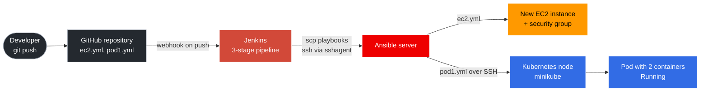
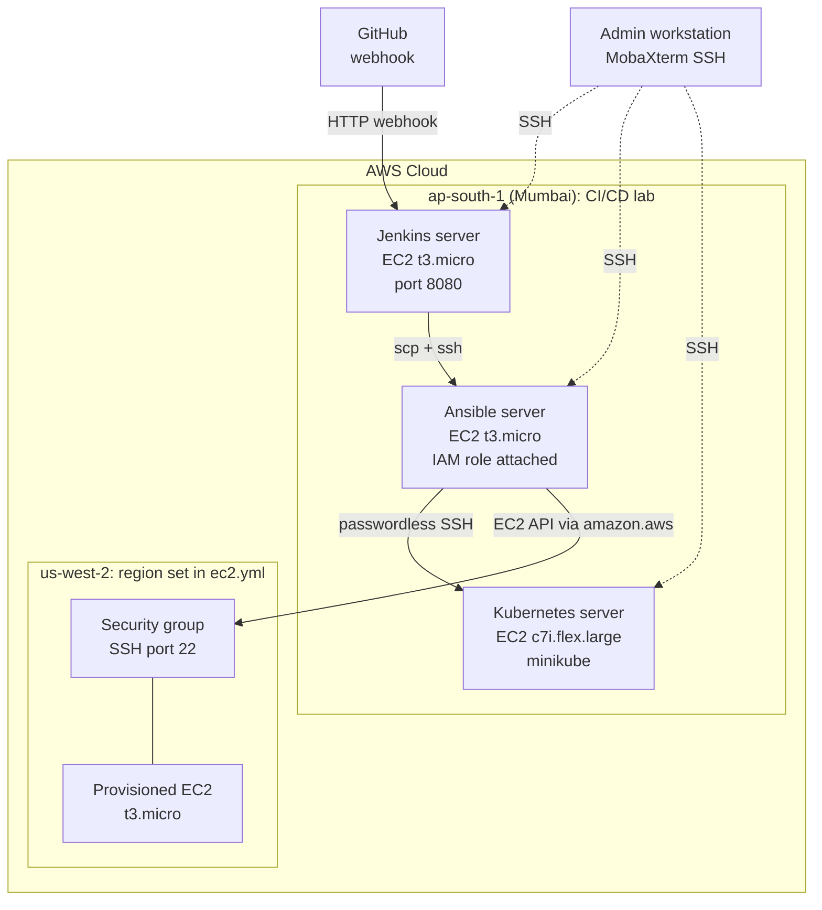
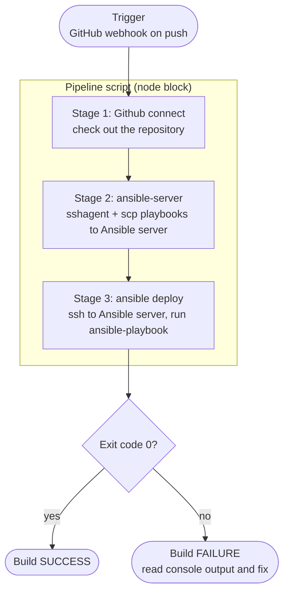
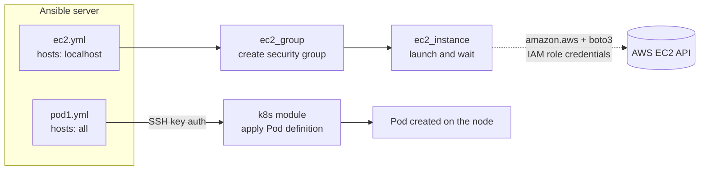
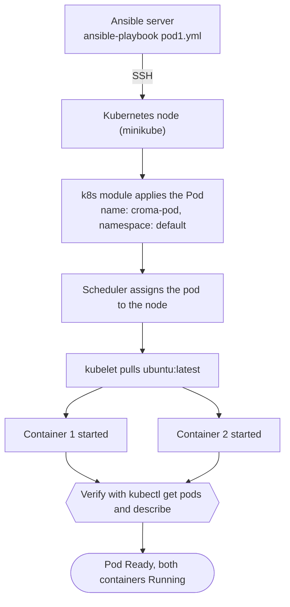
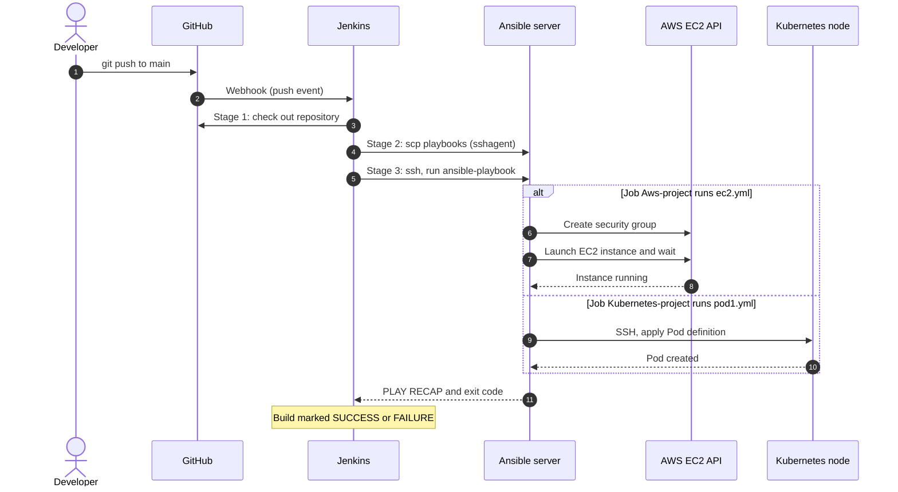
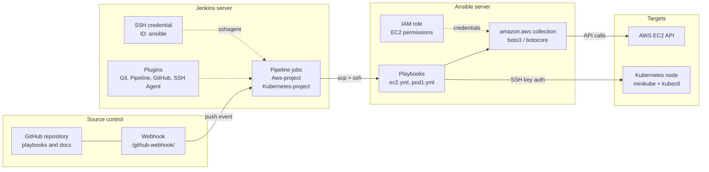
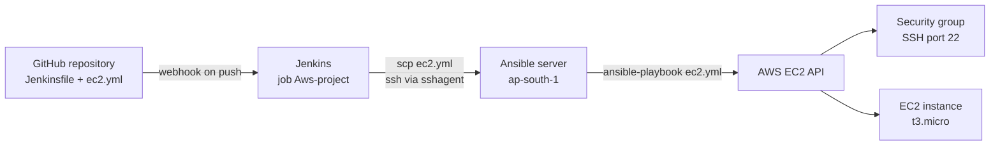
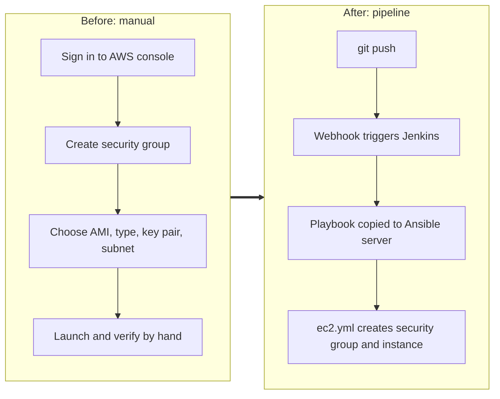

<div align="center">


<a href="https://github.com/PushpenderKumar7505">
  
</a>

<p>
  
  
  
</p>

<p>
  <a href="https://www.linkedin.com/in/pushpender-kumar-5280b7226/"></a>
  <a href="https://cloud-devops-shine.lovable.app/"></a>
  <a href="mailto:pushpender7505@gmail.com"></a>
</p>

<sub>
<a href="#about">About</a> ·
<a href="#skills">Skills</a> ·
<a href="#featured-projects">Projects</a> ·
<a href="#experience">Experience</a> ·
<a href="#education">Education</a> ·
<a href="#analytics">Analytics</a> ·
<a href="#contact">Contact</a>
</sub>

</div>

<div align="center">
  
</div>

<a id="about"></a>


I am a fresher DevOps and Cloud engineer (B.Tech CSE, 2024) who learns by building and documenting. My hands-on work is **CI/CD automation on AWS**: Jenkins pipelines that are triggered by GitHub webhooks, Ansible playbooks that create AWS EC2 infrastructure, and a Kubernetes (minikube) pod deployed from code.

| | |
|---|---|
| **What I have built** | Two Jenkins CI/CD projects on AWS EC2 (see [Featured Projects](#featured-projects)) |
| **How my automation works** | `git push` → GitHub webhook → Jenkins 3-stage pipeline → `scp` + `ssh` to an Ansible server → playbook creates EC2 resources or deploys a Kubernetes pod |
| **Core tools** | Jenkins, Ansible, AWS EC2, Kubernetes + kubectl, Git/GitHub, Linux (Ubuntu) |
| **Training in progress** | Terraform, advanced Kubernetes, Linux administration, monitoring with Prometheus and Grafana |
| **Seeking** | Entry-level DevOps / Cloud roles in Delhi NCR, Noida, Pune or remote |

> Every project below is a **lab / training project** built on my own AWS account. The details shown come from the repositories and their screenshots.

<a id="roles"></a>


`DevOps Engineer (Fresher)` · `AWS Cloud Engineer` · `Junior Cloud Engineer` · `Cloud Infrastructure Engineer` · `DevOps Trainee` · `Cloud Support Associate` · `Junior Site Reliability Engineer`

<a id="skills"></a>


Grouped by how I have actually used each tool, so you can judge depth quickly.

### ✅ Hands-on (used in my projects)

<div align="center">
  
</div>

| Area | What I have done with it |
|---|---|
| **AWS** | Launched and managed EC2 instances, security groups, key pairs and subnets; attached an IAM role so the Ansible server needs no stored access keys |
| **Jenkins** | Installed on EC2; built 3-stage Pipeline jobs; `sshagent` credentials; GitHub webhook trigger |
| **Ansible** | Playbooks using the `amazon.aws` collection and the `k8s` module; passwordless SSH to managed nodes; `ansible -m ping` checks |
| **Kubernetes** | Single-node minikube on EC2; deployed a two-container pod and verified it with `kubectl` |
| **Git / GitHub** | Clone, commit, push, webhooks |
| **Linux (Ubuntu)** | Server setup and SSH-based administration |

### 📘 Training-level (course and labs, not yet in a deployed project)

<div align="center">
  
</div>

Docker · Terraform · Bash scripting · Prometheus · Grafana · AWS S3, VPC and CloudWatch

### 🌱 Currently learning

Terraform on AWS (building hands-on projects) · Advanced Kubernetes · Linux administration fundamentals

### 🗂️ Prior backend experience (internship)

<div align="center">
  
</div>

<a id="featured-projects"></a>


### 1️⃣ AWS Resource Provisioning via Jenkins, Ansible and Kubernetes CI/CD

[](https://github.com/PushpenderKumar7505/Devops-automation-jenkins-ansible)

**Overview.** A three-server CI/CD lab on AWS. A GitHub push triggers Jenkins, Jenkins hands the playbooks to an Ansible server, and Ansible either provisions an EC2 instance (`ec2.yml`) or deploys a Kubernetes pod (`pod1.yml`). Two Jenkins pipeline jobs follow the same 3-stage pattern.

**Technical problem it addresses.** Creating cloud resources and deploying workloads by hand in the console or terminal is slow, easy to get wrong and hard to repeat. Here the steps live in version-controlled playbooks and run the same way every time.

**Stack:** `Jenkins` `GitHub Webhooks` `Ansible` `amazon.aws` `AWS EC2` `Kubernetes (minikube)` `kubectl` `SSH/SCP` `Ubuntu`

#### End-to-end architecture



#### AWS infrastructure



<details>
<summary><b>🔍 More architecture diagrams: Jenkins pipeline, Ansible, Kubernetes, sequence, components</b></summary>

#### Jenkins pipeline execution



#### Ansible automation workflow



#### Kubernetes deployment workflow



#### Provisioning sequence



#### Component interaction



</details>

#### What was verified

| Check | Evidence |
|---|---|
| 3 EC2 instances running (Jenkins, Ansible, Kubernetes) | AWS console screenshot in the repository |
| Passwordless SSH from Ansible server to the managed node | `ansible all -m ping` returned `"ping": "pong"` |
| Pod deployed on minikube and healthy | `kubectl describe pod` shows the pod scheduled to `minikube`, both containers `Running`, conditions `Ready: True` |
| Pipeline pattern | Jenkins job configuration screenshots (3 stages: checkout, scp, `ansible-playbook`) |

<details>
<summary><b>Setup prerequisites</b></summary>

<br>

- **3 Ubuntu EC2 instances:** Jenkins, Ansible control node, Kubernetes node (minikube + `kubectl`)
- **Jenkins:** plugins Git, Pipeline, GitHub, SSH Agent; credential of type *SSH Username with private key* (ID `ansible`, user `ubuntu`)
- **Ansible server:** Ansible, `amazon.aws` collection, `python3-boto3` and `python3-botocore`, plus an IAM role with EC2 permissions attached to the instance (no access keys stored on disk)
- **Kubernetes node:** reachable from the Ansible server over SSH with key-based login (public key in `authorized_keys`)
- **Network:** Jenkins port `8080` open for the GitHub webhook; SSH `22` between the servers
- **Inventory note:** `pod1.yml` uses `hosts: all`, so the Ansible inventory must contain only the Kubernetes node (or run with `--limit`)

</details>

<details>
<summary><b>Installation and execution</b></summary>

<br>

1. Create the three EC2 instances and install Jenkins, Ansible and minikube.
2. Generate an SSH key pair, add the public key to the managed node's `authorized_keys`, and add the private key to Jenkins as credential `ansible`.
3. Verify connectivity from the Ansible server:
   ```bash
   ansible all -m ping
   ```
4. Create a Jenkins Pipeline job with the 3 stages below and enable the *GitHub hook trigger for GITScm polling*.
5. In the GitHub repository add the webhook `http://<jenkins-public-ip>:8080/github-webhook/` (`application/json`, push event).
6. Push a commit to `main` and watch the build in Jenkins.

```groovy
node {
    stage('Github connect') {
        git branch: 'main', url: 'https://github.com/PushpenderKumar7505/Devops-automation-jenkins-ansible.git'
    }
    stage('ansible-server') {
        sshagent(['ansible']) {
            sh 'scp <workspace-path>/* ubuntu@<ansible-private-ip>:/home/ubuntu'
        }
    }
    stage('ansible deploy') {
        sshagent(['ansible']) {
            sh 'ssh ubuntu@<ansible-private-ip> ansible-playbook <playbook>.yml'
        }
    }
}
```

**Validation commands**

```bash
ansible all -m ping          # connectivity: expect "ping": "pong"
kubectl get pods             # on the Kubernetes node: pod listed as Running
kubectl describe pod <name>  # both containers Running, Ready: True
```

</details>

<details>
<summary><b>Project structure</b></summary>

```text
Devops-automation-jenkins-ansible/
├── README.md              # project documentation
├── ec2.yml                # Ansible: security group + EC2 instance (amazon.aws)
├── pod1.yml               # Ansible: two-container Kubernetes pod (k8s module)
└── *.png                  # 12 screenshots (Jenkins, Ansible, kubectl, AWS console)
```

</details>

<details>
<summary><b>Limitations and future improvements</b></summary>

<br>

- Security group in `ec2.yml` allows SSH from `0.0.0.0/0`. Next step: restrict it to a trusted CIDR.
- `ec2.yml` targets `us-west-2` while the CI/CD servers run in `ap-south-1`. Next step: make region, AMI, key and subnet variables.
- Pipeline scripts for this project are configured inside Jenkins. Next step: commit a `Jenkinsfile` (as done in project 2) so the pipeline itself is version-controlled.
- The pod runs `sleep` placeholder containers. Next step: deploy a real application image with a Deployment and Service.
- Next steps on my roadmap: Terraform for the AWS layer, Ansible roles and Vault, Prometheus and Grafana monitoring, HTTPS for Jenkins.

</details>


### 2️⃣ Automated AWS EC2 Provisioning via Jenkins CI/CD

[](https://github.com/PushpenderKumar7505/Jenkins-ansible-aws-ec2-provisioning)

**Overview.** A GitHub push triggers the Jenkins job `Aws-project`. Its `Jenkinsfile` (stored in the repository) copies `ec2.yml` to an Ansible server and runs it, which creates a security group and an EC2 instance. No AWS console clicks are needed for provisioning.

**Stack:** `Jenkins` `GitHub Webhooks` `Ansible` `amazon.aws` `AWS EC2` `AWS IAM role` `Groovy` `YAML` `Ubuntu`



#### Before vs after



| Topic | Detail |
|---|---|
| **Jenkins job** | `Aws-project`, Pipeline script from SCM (`Jenkinsfile`), 3 stages: `Github connect`, `ansible-server`, `ansible deploy` |
| **Build history** | 6 builds: #1 failed, #2 to #6 successful (last build about 18 seconds) |
| **GitHub webhook** | `/github-webhook/`, `application/json`, push event; GitHub shows "Last delivery was successful" |
| **AWS IAM** | IAM role with EC2 permissions attached to the Ansible server, so no access keys are stored on it |
| **EC2 provisioning** | `amazon.aws.ec2_group` then `amazon.aws.ec2_instance` (`wait: yes`), then a `debug` task prints the new instance ID and state |
| **Validation** | `ansible -m ping` returns `pong`; Jenkins dashboard shows the job green; webhook delivery succeeded |

<details>
<summary><b>Limitations of this lab setup</b></summary>

<br>

SSH open to `0.0.0.0/0` on the created security group · `StrictHostKeyChecking=no` in the pipeline · Jenkins on plain HTTP · playbook region (`us-west-2`) differs from the CI/CD servers (`ap-south-1`). Documented in the repository with the planned hardening steps.

</details>

<a id="experience"></a>


| Role | Organisation | Period |
|---|---|---|
| **Associate, FTH** (Incident Response) | UnitedLex India, Gurugram | Jul 2026 |
| **Market Research Associate Intern** | Precise Research Solutions, Gurugram | Jan 2025 – Jun 2025 |
| **Backend Developer Intern** | Mentobile Technologies | Jul 2024 – Oct 2024 |

- **UnitedLex:** Investigated data breaches and classified PII/PHI in affected datasets using Relativity and Microsoft 365.
- **Precise Research Solutions:** Cleaned and analysed structured datasets and produced decision-support reports for stakeholders.
- **Mentobile Technologies:** Built backend modules in CodeIgniter (MVC), designed MySQL schemas and CRUD operations, and worked with Git branching, pull requests and code reviews.

<a id="education"></a>


- 🎓 **B.Tech, Computer Science & Engineering**, GLA University, Mathura (2020 – 2024)
- 🏅 **AWS & DevOps Infrastructure Training**, Croma Campus (NASSCOM-certified, Wipro Credential Partner), Sep 2025 – Mar 2026
- 📚 Also completed: Web Development Bootcamp (JOVAC) · Front-End Development, HTML & CSS (Great Learning) · Course on Computer Concepts, CCC (NIELIT)

<a id="analytics"></a>


These cards are generated live from my public GitHub activity.

<div align="center">
  
  
</div>

<div align="center">
  
</div>

<div align="center">
  
</div>

#### Repository highlights

<div align="center">
  <a href="https://github.com/PushpenderKumar7505/Devops-automation-jenkins-ansible"></a>
  <a href="https://github.com/PushpenderKumar7505/Jenkins-ansible-aws-ec2-provisioning"></a>
</div>

<a id="contact"></a>


I am looking for an entry-level **DevOps / AWS Cloud / Cloud Infrastructure** role where I can keep automating and documenting. Available to join immediately.

<div align="center">
  <a href="https://www.linkedin.com/in/pushpender-kumar-5280b7226/"></a>
  <a href="https://cloud-devops-shine.lovable.app/"></a>
  <a href="mailto:pushpender7505@gmail.com"></a>
</div>


